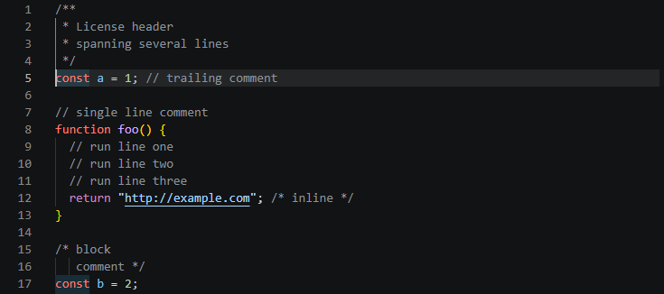
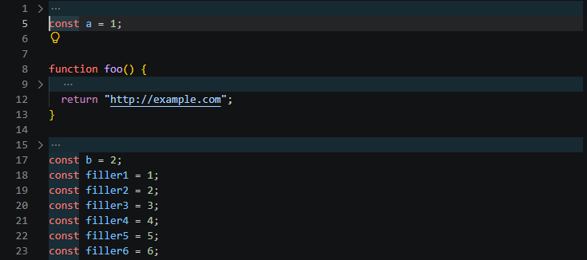

# Hide the Comment

A VS Code extension that hides every comment in your code base with one button, so you can read
the code on its own. Your files are never modified: comments are only hidden from view, and one
more click brings them back.

| Comments shown | Comments hidden |
| --- | --- |
|  |  |

## Features

- **One toggle for the whole workspace.** It applies to every file you open and is remembered the
  next time you open the folder.
- **Three ways to toggle:** the eye icon at the top right of any editor, the **Comments** button in
  the status bar (it turns amber while comments are hidden), or **Hide Comments: Toggle Comments**
  in the Command Palette (`Ctrl+Shift+P`).
- **Comment blocks collapse.** A run of comment-only lines, such as a licence header or a doc
  block, folds down to a single `⋯` line. Click the arrow in the gutter to peek at one.
- **End-of-line comments disappear too,** leaving just the code on that line.
- **You never edit blind.** A comment reappears while your cursor is inside it or at its end, or
  while it is part of your selection, so you cannot type into or copy text you cannot see.
- **Works across languages.** Comment syntax is read from each language's own configuration, so
  any language VS Code knows (JavaScript, Python, Java, C/C++, HTML, CSS, and so on) is covered
  without extra setup.
- **No dependencies and no build step.**

## Install

**From the VS Code Marketplace:** open the Extensions view in VS Code, search for
**Hide the Comment** and click **Install**. Or go to its
[Marketplace page](https://marketplace.visualstudio.com/items?itemName=KevinNguyen.hide-comments).

**From a `.vsix` file:**

1. Download `hide-comments-0.1.1.vsix` from the
   [Releases](https://github.com/kevnguyentech/hide-the-comment/releases) page.
2. In VS Code, open the Extensions view, click the `...` menu at its top right, choose
   **Install from VSIX...**, and pick the downloaded file.

Or from a terminal, in the folder where you saved the file:

```
code --install-extension hide-comments-0.1.1.vsix
```

Requires VS Code 1.75 or newer.

## Settings

| Setting | Default | What it does |
| --- | --- | --- |
| `hideComments.collapseBlocks` | `true` | Fold runs of comment-only lines to one line. Turn it off to keep every line in place, with hidden comments shown as blank lines. |

## How it works

VS Code has no API for hiding text, so the extension combines two things:

- **Decorations** hide the comment text itself. Each comment gets a text decoration that sets it
  to `display: none`.
- **Folding** removes the vertical space. The extension registers a folding range provider that
  reports each run of comment-only lines as a foldable comment region, then folds those regions.

To find comments it reads the comment tokens from the `language-configuration.json` of whichever
extension provides the language, then scans the document for those tokens while stepping over
string literals.

| File | Role |
| --- | --- |
| [`src/extension.js`](src/extension.js) | Commands, buttons, decorations and folding |
| [`src/scanner.js`](src/scanner.js) | Finds comments and comment-only line runs in text |
| [`src/rules.js`](src/rules.js) | Turns a language configuration into comment rules |
| [`src/languages.js`](src/languages.js) | Loads language configurations from installed extensions |

## Limitations

- Comment detection is a token scan, not a full parser. Unusual constructs, such as a here-document
  or a regex literal containing a quote, can occasionally hide the wrong text or miss a comment.
  Nothing is ever changed on disk.
- Python docstrings are strings, not comments, and stay visible.
- VS Code can fold lines but cannot remove a single line from view, so a lone comment line shows as
  a blank line, and a folded block still takes up one line.
- Folding commands only work on the focused editor. In a split view, the other pane hides its
  comments immediately but folds (or unfolds) its comment blocks when you click into it.
- Folding is skipped when `editor.foldingStrategy` is set to `indentation`.

## Development

Clone the repository, open the folder in VS Code and press `F5`. A second VS Code window opens
with the extension loaded.

- **Tests** (needs Node.js 18 or newer): `node test/scanner.test.js`
- **Package a `.vsix`** (PowerShell only, no Node.js needed):
  `powershell -ExecutionPolicy Bypass -File build.ps1`

## License

Licensed under the [PolyForm Noncommercial License 1.0.0](LICENSE). You are free to use, change
and share this extension for non-commercial purposes only. Commercial use is not permitted.

[@Copyright Kevin Nguyen](LICENSE)
